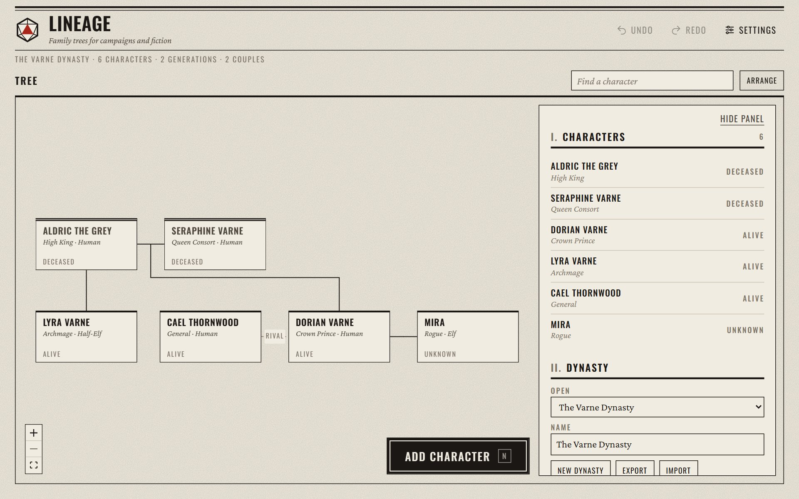
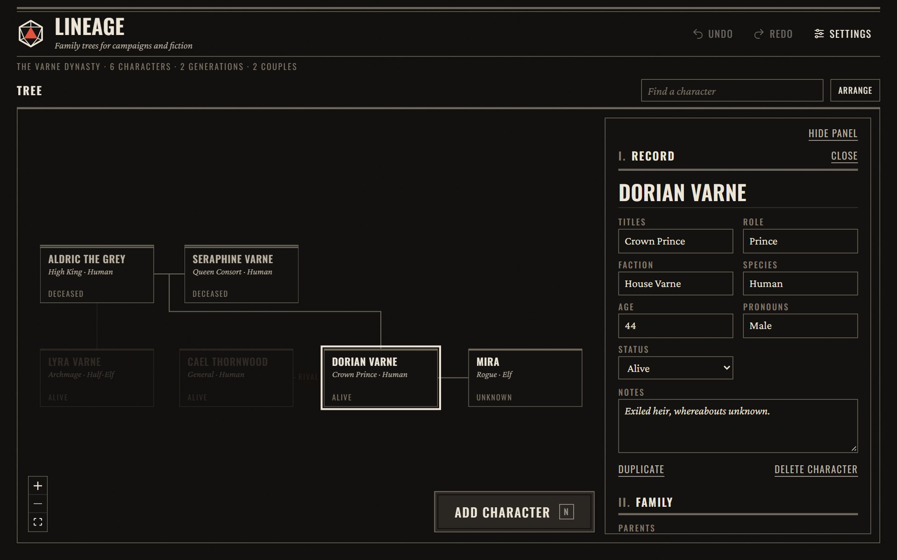
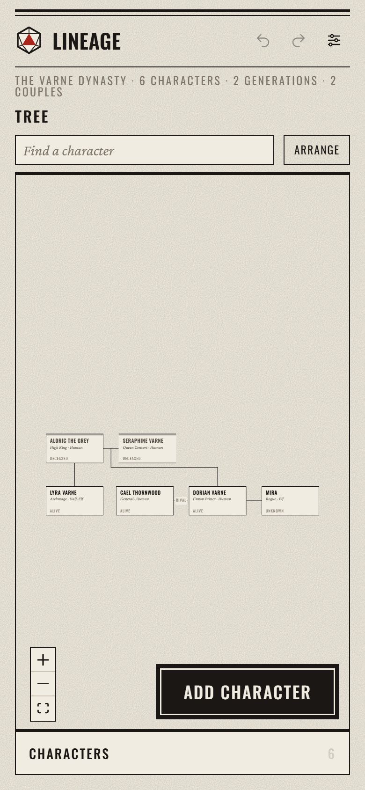

# Lineage — Fantasy Family Tree App

A web app for building and viewing family trees for tabletop RPG campaigns, worldbuilding and fiction. Everything stays in your browser.

**Use it at [lineage.dungeongadgets.com](https://lineage.dungeongadgets.com/)**. No install or account needed.



<table>
  <tr>
    <td width="70%"></td>
    <td width="30%"></td>
  </tr>
</table>

---

## Features

- **Automatic layout** that keeps couples side by side and children beneath them; drag a card to adjust it, **Arrange** to reset
- **Character records** for name, titles, role, faction, species, age, pronouns, status and notes
- **Family and social relationships**: parents, partners, children and siblings, plus Adopted, Guardian, Rival, Ally, Enemy, Mentor, Apprentice and Other
- **Hereditary traits** that pass to children as Carrier or Unaffected
- **Several dynasties** in one browser, with import and export
- **A floating, collapsible panel** for the character list and records; the mouse wheel zooms the tree everywhere else
- **Search**, lineage highlighting for the selected character, and undo/redo (Ctrl+Z / Ctrl+Shift+Z)
- **Light and dark** appearance in the DungeonTools style, laid out for phones as well as desktops

---

## Running it locally

```bash
npm install
npm run dev
```

Then open http://localhost:5173. To produce a static build you can host anywhere, run `npm run build`; the result is in `dist/`.

All data is saved in your browser (IndexedDB). No server or account is needed. To move a tree from the original app, export it there and use **Import** here; v1 `.lineage.json` files are converted automatically.

---

## Tech Stack

- React + TypeScript, built with Vite
- React Flow for the canvas, ELK for automatic layout
- Zustand + zundo for state and undo/redo
- Zod validation for imported files and stored data
- IndexedDB for local persistence

The original single-file version is kept in `legacy/index.html`.

---

## Species Presets

Human, Elf, Dwarf, Halfling, Orc, Tiefling, Dragonborn, Gnome, Half-Elf, Undead

---

## License

MIT. See [LICENSE](LICENSE) for details.
